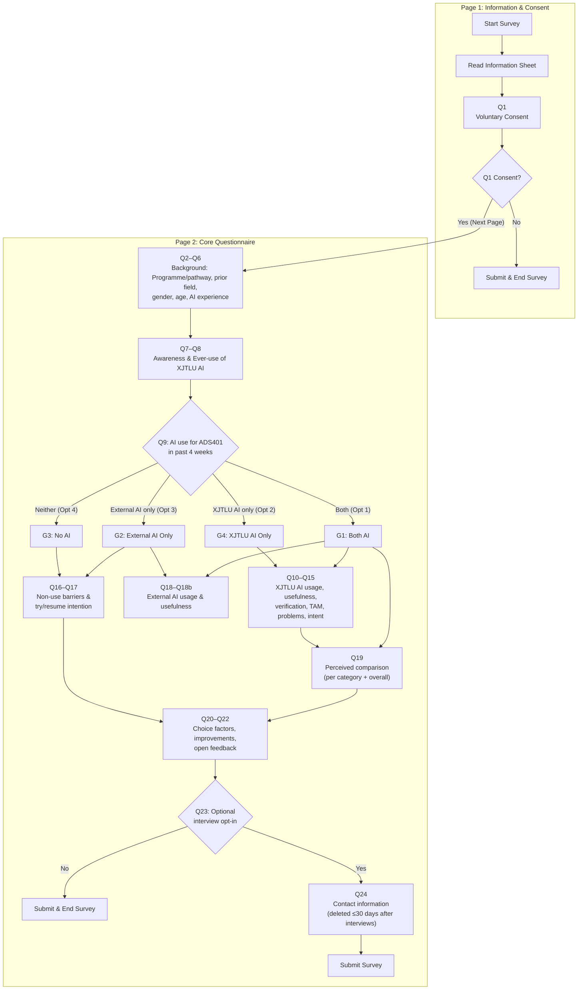

# Questionnaire v2 Flow (v2.2)

Branching per the v2.2 jump-logic table (doc numbering Q1–Q24 + Q11a/Q18a/Q18b;
WJX display numbers 1–27, map in `deploy/DEPLOY.md`).

## Jump-logic table (WJX configuration source)

| Condition | Action |
| --- | --- |
| Q1 = No | Next Page → Submit & End Survey (Page 1 pagination isolation) |
| Q1 = Yes | Proceed to Page 2 (Q2..Q24) |
| Q9 = Both (Opt 1) | Show Q10–Q15, Q18–Q18b, Q19 |
| Q9 = XJTLU AI only (Opt 2) | Show Q10–Q15; skip Q16–Q17, Q18–Q18b, Q19 |
| Q9 = External AI only (Opt 3) | Show Q16–Q17, Q18–Q18b; skip Q10–Q15, Q19 |
| Q9 = Neither (Opt 4) | Show Q16–Q17; skip Q10–Q15, Q18–Q18b, Q19 |
| Q23 = No | Submit & End Survey |
| Q23 = Yes | Show Q24 (Contact Details) |

## Key Design Principles

1. **Page 1 Isolation**: A page break is inserted immediately after Q1. Unconsenting participants submit immediately without viewing subsequent research questions.
2. **Q9 Natural Gradient**:
   1. Both XJTLU AI and External AI
   2. XJTLU AI only (no External AI)
   3. External AI only (no XJTLU AI)
   4. Neither XJTLU AI nor External AI (placed at the bottom)
3. **Other-Item Handling**:
   - Q11: `Other (please specify) ______` includes a text fill-in.
   - Q18: `Other (please specify; if same as Q11, state 'Same as Q11') ______` avoids redundant typing.
   - Matrices (Q11a, Q18b, Q19): Clean category rows without A–F letter prefixes. Q19 includes `Other activity (if applicable)`.
4. **Separate Deployments for EN and CN**:
   - Single-language surveys per deployment link (identical column structures).
   - Avoids doubling questionnaire size (54 questions) and messy multi-language branch logic in a single survey.
