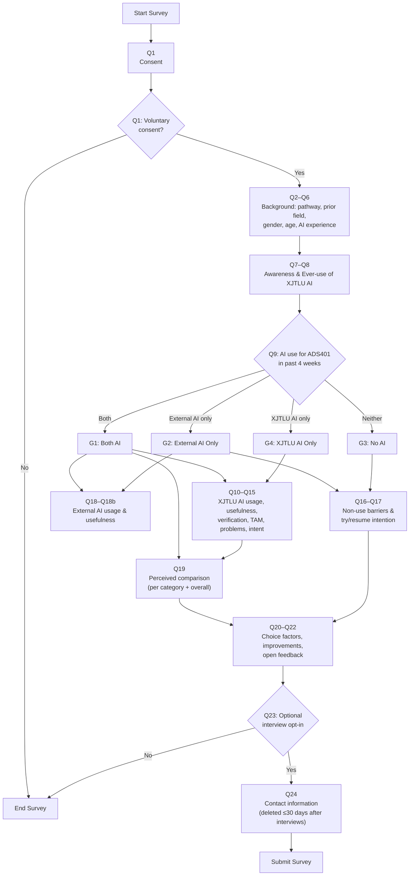

# Questionnaire v2 Flow (v2.1)

Branching per the v2.1 jump-logic table (doc numbering Q1–Q24 + Q11a/Q18a/Q18b;
WJX display numbers 1–27, map in `deploy/DEPLOY.md`).

## Jump-logic table (WJX configuration source)

| Condition | Action |
| --- | --- |
| Q1 = No | End survey |
| Q9 = Both | Show Q10–Q15, Q18–Q18b, Q19 |
| Q9 = External AI only | Show Q16–Q17, Q18–Q18b; skip Q19 |
| Q9 = Neither | Show Q16–Q17; skip Q18–Q18b, Q19 |
| Q9 = XJTLU AI only | Show Q10–Q15; skip Q16–Q17, Q18–Q18b, Q19 |
| Q23 = No | End survey |

## Notes

- Q7 (awareness) is asked of everyone; Q8 (ever-use) likewise — no skip.
- Q22 (comparison) requires dual use by construction: only the Both branch sees it.
- Groups: G1 Both AI / G2 External AI Only / G3 No AI / G4 XJTLU AI Only —
  same four-group plan as scripts.md.
- v1 comparison figure: `questionnaire_v1_flow_fig.svg`. Re-render this v2
  figure to SVG when the deck needs it (mermaid-cli or GitHub render).
