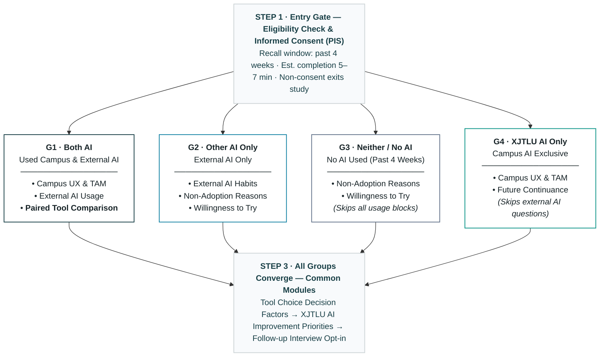

<!-- Slide 1: Cover -->

  

    ADS401 · PRESENTATION 2 · EVALUATION DESIGN
  

  
ADS401 Students' Perspective on AI Agents at XJTLU

  

    An empirical HCI evaluation of awareness, adoption, and use of campus AI services
  

  <b>Group A</b> · Hongcheng TANG · Mingjian TAO · Liyuan CHEN · <b>Haode SHEN</b> <i>(Presenter)</i> 
  19 October 2026

<!--
Notes [15s] · 开场问候与破题 (演讲者: 申昊德)
【英文演讲词】:
"Hello everyone. // We are Group A. My name is Haode SHEN. // Today our study explores ADS401 students' awareness and use // of AI services provided by XJTLU."

【中文要义】:
大家下午好，我们是第一组，我是主讲人申昊德。今天我们汇报的研究关注 ADS401 同学对西浦校内 AI 服务的认知和使用情况。

【发音指南】:
- Haode SHEN [haʊ-də ʃɛn]
- awareness [ə-ˈwɛər-nəs] 认知度
- provided by XJTLU [prə-ˈvaɪ-dɪd baɪ ...]
-->

---
title: Outline
---

<!-- Slide 2: Outline (Scheme A) -->

  Presentation Outline

  

    
01 · CONTEXT &amp; MOTIVATION

    
Official AI Deployment vs. External AI Habits

  

  

    
02 · RESEARCH QUESTIONS

    
Three Core Questions: Awareness, Tasks &amp; Factors

  

  

    
03 · METHODOLOGY &amp; SAMPLING

    
Sequential Mixed Methods &amp; 46-Student Census

  

  

    
04 · SURVEY INSTRUMENT

    
Adaptive Routing Across Four Observed Groups

  

  

    
05 · PLANNED INTERVIEWS

    
Purposive Sampling &amp; Artifact Walkthroughs

  

  

    
06 · STUDY BOUNDARIES

    
Pre-Registered Limitations &amp; Milestone Roadmap

  

<!--
Notes [10s] · 大纲导引
【英文演讲词】:
"Our presentation covers six core topics: // our research context and motivation, // three focused research questions, // methodology and census sampling, // survey routing across four usage groups, // and finally our planned interviews and pre-registered boundaries."

【中文要义】:
我们的汇报主要覆盖六个核心部分：背景与动机、三个研究问题、方法与近普查抽样、问卷四组自适应路由，以及最后的后续访谈和诚实局限性。
-->

---
title: Context & Motivation
---

<!-- Slide 3: Context & Motivation -->

  Institutional AI Exists — But Are Students Actually Using It?

  

    
01 · Campus Deployment

    
Official University AI Services

    

      XJTLU provides official AI agent services, including the <b>Junmou AI Agent Platform</b> and <b>Learning Mall chatbots</b>, to support learning and coursework.
    

  

  

    
02 · Student Reality

    
Heavy External Commercial AI Use

    

      ADS401 students actively rely on external commercial AI (ChatGPT, DeepSeek, Kimi) for daily programming, academic writing, and concept debugging.
    

  

  

    
03 · The Empirical Gap

    
Adoption &amp; Non-Use Unexamined

    

      Do students know campus AI exists? How is it used, and why do many choose external tools instead? This remains an empirical black box.
    

  

  Research Aim:
  
    Explore ADS401 students' use or non-use of XJTLU AI and the reasons behind their choices, to inform future improvements to university AI services.
  

<!--
Notes [18s] · 背景与现实矛盾 (对齐 Speech1.0 Para 2)
【英文演讲词】:
"To begin, // we will explain why this topic matters. // Although XJTLU provides services such as Junmou AI to support learning, // students' awareness, usage, and reasons for using or not using these tools // remain unclear."

【中文要义】:
首先，我们说明为什么关注这个问题。虽然学校提供了君谋 AI 等服务来支持学习，但学生究竟是否了解这些工具、具体如何使用，以及为什么选择使用或不使用，目前还不清楚。

【发音指南】:
- Junmou AI [dʒuːn-moʊ eɪ-aɪ]
- awareness [ə-ˈwɛər-nəs]
-->

---
title: Research Questions
---

<!-- Slide 4: Research Questions (3 Horizontal Rows) -->

  Three Core Research Questions

  

    

      RQ1 · Awareness &amp; Adoption
      To what extent are students in our ADS401 module aware of and adopting XJTLU AI?
    

    

      Investigates baseline familiarity with campus AI services, lifetime ever-use, and actual module-specific adoption in ADS401 learning over the past four weeks.
    

  

  

    

      RQ2 · Usage Patterns
      How do students in ADS401 use XJTLU AI for their academic tasks?
    

    

      Examines usage frequency, distribution across coursework task categories (course materials, research planning, data analysis, writing), and verification habits.
    

  

  

    

      RQ3 · Factors &amp; Comparison
      What perceived benefits, barriers, and tool differences are associated with adoption choices and future intentions?
    

    

      Explores perceived usefulness, ease of use, trust, reported obstacles, perceived trade-offs against external commercial AI, and future continuance intentions.
    

  

<!--
Notes [22s] · 三大核心研究问题 (对齐 Speech1.0 Para 3)
【英文演讲词】:
"Based on this background, // we developed three research questions: // How aware of and willing to adopt university-provided AI are students? // How do they use it for ADS401 learning? // And what perceived benefits, barriers, and differences between tools // are associated with their choices and future intentions?"

【中文要义】:
围绕这一背景，我们提出了三个研究问题：学生对校内 AI 的认知和采纳程度如何？他们如何将其用于 ADS401 学习？哪些收益、障碍和工具差异与他们的选择及未来使用意愿有关？
-->

---
title: Methodology & Sampling
---

<!-- Slide 5: Methodology & Census Sampling -->

  Explanatory Sequential Design with a 46-Invitee Cohort Census

  

    
01 · Mixed-Methods Sequence

    

      Explanatory Sequential Design
    

    

      

        <b>Phase 1 · Quantitative Survey:</b> Cross-sectional online survey to map cohort-wide awareness, usage patterns, and user perceptions (<i>What &amp; How many</i>).
      

      
↓ Survey patterns inform interview sampling

      

        <b>Phase 2 · Qualitative Interviews:</b> Semi-structured follow-up interviews to explain the motivations, barriers, and reasons behind observed choices (<i>Why &amp; How</i>).
      

    

  

  

    
02 · Cohort Census &amp; Paired Comparison

    

      Targeting the Module Population (N=50)
    

    <ul class="dense-list mt-3">
      <li><b>Census-adjacent reach:</b> 50 enrolled students → 4 researchers excluded → <b>46 eligible invitees</b> (voluntary participation).</li>
      <li><b>Descriptive boundaries:</b> Given cohort size (N≈50), analysis relies strictly on <b>descriptive statistics and cross-tabulations</b>; no causal claims.</li>
      <li><b>Paired tool comparison:</b> Evaluated via <b>paired activity ratings among dual users</b> across identical task categories, directly controlling for individual differences.</li>
    </ul>
  

<!--
Notes [22s] · 混合方法与抽样 (对齐 Speech1.0 Para 4)
【英文演讲词】:
"To answer these questions, // we use an explanatory sequential mixed-methods design: // first a cross-sectional online survey, // followed by interviews informed by the survey findings. // Our target population is all ADS401 students. // There are 50 students in the module; // after excluding four student researchers, // we plan to invite 46 students."

【中文要义】:
为回答这些问题，我们采用解释性顺序混合方法：先开展横断面在线问卷，再根据问卷结果进行访谈。研究对象是 ADS401 全体学生。目前课程有 50 名学生，排除 4 名研究者后，计划邀请 46 名学生参与。
-->

---
title: Survey Routing
---

<!-- Slide 6: Survey Routing & Four Usage Groups -->

  21-Item Survey with Four-Group Adaptive Routing

<!--
Notes [28s] · 问卷架构与四组路由 (演讲者: 申昊德 · 对齐 Speech1.0 Para 5)
【英文演讲词】:
"The pilot questionnaire takes about five to seven minutes // and asks mainly about learning in the past four weeks. // As shown in this flowchart, // we screen for eligibility and consent first, // then adaptively route students into four groups based on recent use. // Dual users compare both tools directly, // while non-users share reasons for non-adoption without rating unexperienced features. // Finally, all groups converge to answer decision factors and improvement priorities."

【中文要义】:
预测试问卷预计需要 5–7 分钟，主要询问过去四周的学习经历。正如流程图所示，我们首先进行资格与知情同意门禁，然后根据近四周实际使用情况将学生自适应分流为四组。双工具用户开展配对比较，而未使用者只回答未采纳原因，避免对未体验过的功能虚假打分。最后，全员汇合回答工具选择因素与改进优先级。
-->

---
title: Planned Interviews
---

<!-- Slide 7: Planned Follow-up Interviews -->

  Planned Follow-up Interviews to Explain Survey Patterns

  

    
01 · Purposive Interview Sampling

    

      4–6 Students with Contrasting Experiences
    

    <ul class="dense-list mt-3">
      <li><b>Timing &amp; status:</b> Planned Phase 2 follow-up; scheduled after initial survey analysis.</li>
      <li><b>Recruitment:</b> Sampled from survey respondents who voluntarily opt into follow-up contact.</li>
      <li><b>Quota Priority:</b> Prioritising <b>Both AI (G1)</b> and <b>Other AI Only (G2)</b> to understand why students substitute external tools for campus AI.</li>
      <li><b>Format &amp; Duration:</b> 15–20 minutes semi-structured interviews.</li>
    </ul>
  

  

    
02 · Qualitative Triangulation

    

      Contextual Walkthroughs &amp; Theme Integration
    

    <ul class="dense-list mt-3">
      <li><b>Artifact walkthrough:</b> Grounded in specific coursework experiences, prompt workflows, and perceived obstacles.</li>
      <li><b>Thematic coding:</b> Code transcripts and develop recurring themes following Braun &amp; Clarke (2006).</li>
      <li><b>Integration:</b> Connect qualitative themes directly with survey distributions (Fetters et al., 2013) to explain adoption mechanisms.</li>
    </ul>
  

<!--
Notes [20s] · 追踪访谈与定性整合 (对齐 Speech1.0 Para 6)
【英文演讲词】:
"After collecting the survey data, // we will use interviews to explore the reasons behind the patterns. // We plan to select four to six students // with different levels of perceived usefulness. // Starting from specific experiences, // the interviews will explore the reasons behind their ratings and tool choices, // and we will connect these themes with the survey findings."

【中文要义】:
问卷收集之后，研究将进一步通过访谈解释数据背后的原因。我们计划选择 4–6 名学生，尽量覆盖不同的有用性感知；访谈从具体经历出发，探讨评分和工具选择的原因，再将访谈主题与问卷结果对照。

【防问提示】:
考官若追问，明确说明：访谈是问卷初步分析后的解释性后续计划（Planned Follow-up），目前尚未开展，我们重点在问卷严密性。
-->

---
title: Limitations & Next Steps
---

<!-- Slide 8: Limitations, Materials & Next Steps -->

  Pre-Registered Limitations &amp; Implementation Roadmap

  

    
01 · Five Pre-Registered Limitations

    

      Honest Scope of Claims
    

    <ul class="dense-list mt-3">
      <li><b>Single-module sample:</b> Focuses on ADS401 students; findings describe participants and do not generalise across XJTLU.</li>
      <li><b>Self-reported data:</b> Relies on subjective student recall, not telemetry system logs.</li>
      <li><b>Interview coverage:</b> Prioritising G1/G2 may under-represent non-user perspectives.</li>
      <li><b>Cross-sectional design:</b> Captures recent use and future intentions, not longitudinal causality.</li>
      <li><b>Perception-based comparison:</b> Reflects user experience, not objective model benchmarks.</li>
    </ul>
  

  

    
02 · Materials &amp; Next Milestones

    

      Ready for Data Collection
    

    

      <b>Completed Materials (Consolidated in material.md):</b>
      

        • Survey instrument v1 (pilot) with Participant Information Sheet (PIS) &amp; informed-consent gate 
        • Semi-structured interview protocol &amp; recruitment flow 
        • Live web report: lionchena.github.io/ads401
      

      <b>Next Steps:</b>
      

        Internal 4-researcher check → Survey fielding (19 Oct – 02 Nov) → Preliminary analysis → Follow-up interviews → Presentation 3 (09 Nov).
      

    

  

<!--
Notes [22s] · 局限性反思与下一步 (对齐 Speech1.0 Para 7)
【英文演讲词】:
"Finally, // this study focuses on one module and relies on self-reported data, // so the findings may not represent students in other courses. // A cross-sectional survey also cannot establish causality or long-term use. // Even so, // the study can help us understand ADS401 students' AI choices // and identify possible improvements to university AI services."

【中文要义】:
最后，本研究聚焦单一课程并依赖自我报告数据，因此结果不一定代表其他课程学生的情况。横断面调查也不能证明因果关系或长期使用情况。尽管如此，研究仍能帮助我们理解 ADS401 学生的 AI 使用选择，并为改进校内 AI 服务提供参考。

【发音指南】:
- causality [kɔː-ˈzæl-ə-ti] 因果性
- cross-sectional [krɒs ˈsɛk-ʃə-nəl]
-->

---
title: Summary
---

<!-- Slide 9: Summary & AI-Use Disclosure -->

  Summary — What, How &amp; When

  

    
01 · What

    

      Evaluation Design
    

    

      An explanatory sequential mixed-methods study of ADS401 students' awareness, adoption, and use of XJTLU AI services.
    

  

  

    
02 · How

    

      Census Survey + Interviews
    

    

      A 46-invitee cohort census (past-4-week window) with four-group adaptive routing, followed by 4–6 semi-structured interviews.
    

  

  

    
03 · When

    

      Timeline
    

    

      Survey fielding 19 Oct – 02 Nov; preliminary analysis and interview planning leading to Presentation 3 (09 Nov).
    

  

<!--
Notes [15s] · 总结与AI使用披露 (新增收尾段)
【英文演讲词】:
"To summarize: // a mixed-methods evaluation of XJTLU AI in our cohort, // a census survey followed by interviews, // fielding from October 19th to November 2nd. // Findings will be reported at Presentation 3. // We also disclose that AI assisted only with layout and language polishing — // all research decisions are our own."

【中文要义】:
总结：我们将在 ADS401 同学中开展混合方法评估——近普查问卷加追踪访谈，10 月 19 日至 11 月 2 日发放问卷，结果在 Pres 3 汇报。同时披露：生成式 AI 仅用于排版与语言润色等非实质性辅助，所有研究决策由组员自主完成。
-->

---
title: Q & A
---

<!-- Slide 10: Q&A / Discussion & Thank You -->

  

    Q &amp; A
  

  

    Thank you for your attention. We welcome your questions and feedback.
  

  

    

      Project Resources &amp; Documentation
    

    

      • <b>Live Web Report:</b> https://lionchena.github.io/ads401/ 
      • <b>Interactive Web Slides:</b> https://lionchena.github.io/ads401/slides/ 
      • <b>Group A:</b> Hongcheng TANG · Mingjian TAO · Liyuan CHEN · Haode SHEN
    

  

<!--
Notes · 现场答辩常驻页面 (3分钟 Q&A 期间全程停留在此页)
【收尾致谢英文】:
"Thank you very much. // We now welcome any questions or suggestions from Dr. Li and our fellow classmates."

【中文答辩速记备忘 (高频四大质询理由)】:
1. 问：为什么只选 46 个人？
   -> 答：“我们是全班近普查（N=50，排除我们 4 个研究者后全量邀请 46 人），不是朋友圈便利抽样。”
2. 问：样本量小为什么不做独立样本 t 检验？
   -> 答：“根据横断面调研规范，小样本做组间推断检验极易产生统计假象。为严谨自守，我们恪守描述统计与交叉分析。”
3. 问：怎么保证没用过校内 AI 的人不在问卷里胡乱打分？
   -> 答：“看我们 Slide 6 的路由设计：Q5 设立了强制自适应跳题，从未使用过的人直接跳过效用打分，直达未采纳原因模块。”
4. 问：关于试测（Pilot Test），你们到底做了没有？
   -> 答：“我们已在组内 4 位研究员中完成了内部走查测试（Internal Walkthrough），校准了问卷填答时间约 5–7 分钟，排除了无关的 VPN 题，重构了频次选项与跳题分流。全员正式发卷定于今天启动，完整数据将在 11 月 Pres 3 汇报。”
5. 问：双用户的配对比较，数据收回来后跑什么具体检验？
   -> 答：“在同一活动类别下对双用户的配对评分，计划跑非参数的 Wilcoxon 符号秩检验（Wilcoxon signed-rank test），非常适合小样本有序变量的配对比较。”
6. 问：为什么你们反复强调非态度偏差（Non-attitude Bias）？
   -> 答：“这是 W4 讲义原则：从未使用过校内 AI 的人缺乏真实体验，强行打分只会产生伪数据噪音，因此我们在 Q5 设立强制跳题将其分流。”
-->

---
title: References & AI Disclosure
---

<!-- Slide 11: References & AI-Use Disclosure (Q&A 收尾停留页) -->

  References &amp; AI-Use Disclosure

<ol class="ref-list">
  <li>Braun, V., &amp; Clarke, V. (2006). Using thematic analysis in psychology. <i>Qualitative Research in Psychology, 3</i>(2), 77–101. <a href="https://doi.org/10.1191/1478088706qp063oa">https://doi.org/10.1191/1478088706qp063oa</a></li>
  <li>Chung, J., Henderson, M., Pepperell, N., Slade, C., &amp; Liang, Y. (2024). <i>Student perspectives on AI in Higher Education: Student Survey</i> [Survey instrument]. Student Perspectives on AI in Higher Education Project. <a href="https://doi.org/10.26180/27915930">https://doi.org/10.26180/27915930</a></li>
  <li>Davis, F. D. (1989). Perceived usefulness, perceived ease of use, and user acceptance of information technology. <i>MIS Quarterly, 13</i>(3), 319–340. <a href="https://doi.org/10.2307/249008">https://doi.org/10.2307/249008</a></li>
  <li>Farinosi, M., &amp; Melchior, C. (2025). To adopt or to ban? Student perceptions and use of generative AI in higher education. <i>Humanities and Social Sciences Communications, 12</i>, Article 1684. <a href="https://doi.org/10.1057/s41599-025-05982-7">https://doi.org/10.1057/s41599-025-05982-7</a></li>
  <li>Fetters, M. D., Curry, L. A., &amp; Creswell, J. W. (2013). Achieving integration in mixed methods designs—Principles and practices. <i>Health Services Research, 48</i>(6 Pt 2), 2134–2156. <a href="https://doi.org/10.1111/1475-6773.12117">https://doi.org/10.1111/1475-6773.12117</a></li>
  <li>Ivankova, N. V., Creswell, J. W., &amp; Stick, S. L. (2006). Using mixed-methods sequential explanatory design: From theory to practice. <i>Field Methods, 18</i>(1), 3–20. <a href="https://doi.org/10.1177/1525822X05282260">https://doi.org/10.1177/1525822X05282260</a></li>
</ol>

  <b>AI-Use Disclosure:</b> Generative AI provided non-substantive assistance only — slide layout, language polishing, and reference formatting. All research decisions, instrument content, and analysis plans are the students' own work.

<!--
Notes · Q&A 收尾停留页 (无需演讲; 若被问及 AI 政策或文献来源, 指向本页)
-->
